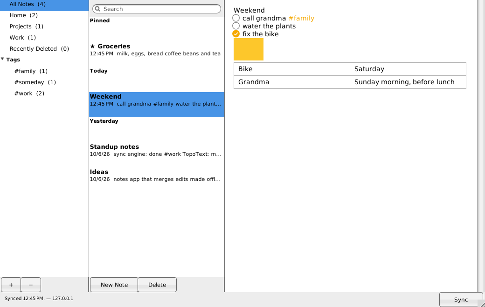
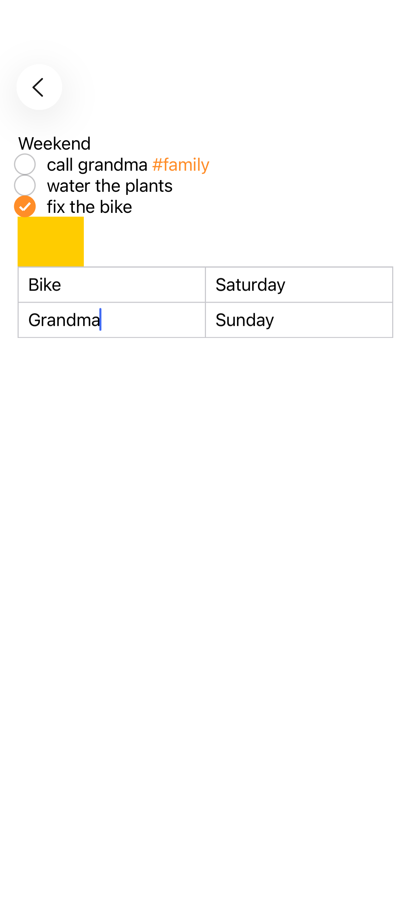

# SimpleNotes

A small, self-hosted Apple Notes, for **macOS, Linux and iPhone/iPad**. Every
note is kept on the device and works offline; notes sync through a server of
your own, `simplenotes-server`. When the same note is edited on two devices
that couldn't reach each other, both edits end up in the note: nobody is
asked to pick a version.

| The AppKit app, on GNUstep (the Eau theme) | On iOS |
|---|---|
|  |  |

## Get it

Download from [Releases](https://github.com/ashalkhakov/TopoText/releases/latest):

| Platform | Download | |
|---|---|---|
| macOS | `SimpleNotes-macOS-*.zip` | Universal, signed and notarized |
| Linux x86_64 | `SimpleNotes-*-x86_64.AppImage` | The app, and the server for a machine without Docker; updated by Gear Lever, AppImageUpdate or AppImagePool |
| iPhone, iPad | `SimpleNotes-iOS-*-unsigned.ipa` | Unsigned: sign it yourself, or build from source |
| The server | `ghcr.io/ashalkhakov/simplenotes-server` | A Docker image, amd64 and arm64 |

Run the server, then give its address in the app (**Sync…**; on iOS, the
server button):

```sh
docker run -p 8080:8080 -v notes:/data ghcr.io/ashalkhakov/simplenotes-server
```

That keeps the notes in SQLite in the `notes` volume, for anyone who can
reach the port. For PostgreSQL or MariaDB, a reverse proxy, and signing in
with Keycloak or another OpenID Connect provider, so that each user has a
notebook of their own, see [Running the server](docs/server.md).

**Update the server before the apps.** A server older than an app refuses
it until it is updated ("The service has no schema version N").

## What there is

- **Notes as in Apple Notes**: rich text with titles, headings, lists and
  checklists, block quotes, colours and highlights, collapsible sections,
  links (to the web and to other notes), images, files and tables.
- **Organising**: folders in folders, tags, smart folders, pinning, sorting
  and grouping by date, a gallery view, an attachments browser, search,
  Recently Deleted.
- **In and out**: find and replace, print and export as PDF, sharing from
  other apps (the iOS share sheet, the desktop's Services menu), export as
  Markdown, import from Markdown folders, Obsidian, Joplin, Bear and Trilium.
- **Version history**, kept by the server so every device sees the same
  versions.
- **Sync** with the server, or directly with your devices nearby, with no
  server, on the same network.

How each works: [Using SimpleNotes](docs/features.md) ·
[Export and import](docs/import-export.md).

## How notes merge

A note's text is a [TopoText](../../README.md), a rich text that merges
itself. [ODataSync](https://github.com/ashalkhakov/ODataKit) moves it as a
merged attribute: only what the other side lacks goes over the wire, and text
deleted on every device is eventually forgotten, so a note doesn't grow for
ever. Folders, tables, smart folders' rules and deletions merge too; see
[How SimpleNotes is built](docs/architecture.md).

## Limitations

- **Linux** runs the AppKit app through GNUstep, with patches of ours to
  GNUstep (in [gnustep-patches](https://github.com/ashalkhakov/gnustep-patches))
  until they are upstream. Dragging in the sidebar doesn't work there yet;
  use File > Move To and Move Folder To.
- **iOS** has no App Store or TestFlight build yet.
- **Not yet**: sharing a note with another user, locked notes, document
  scanning, sketches, audio, Spotlight, widgets, a web client, Windows.

## Documentation

- [Using SimpleNotes](docs/features.md): every feature, and how it syncs
- [Export and import](docs/import-export.md)
- [Running the server](docs/server.md): settings, Docker, databases, moving
  to another database, a reverse proxy, signing in
- [On Proxmox VE](docs/Proxmox.md): a container from the image, with Keycloak
- [How SimpleNotes is built](docs/architecture.md): its parts, and how a
  note's rich text is kept
- [Model versions](docs/model-versions.md): migrations, and adding a version
- [Developing SimpleNotes](docs/development.md): running from source, the
  checks, releases

## License

LGPL 2.1 or later, as [TopoText](../../README.md).
